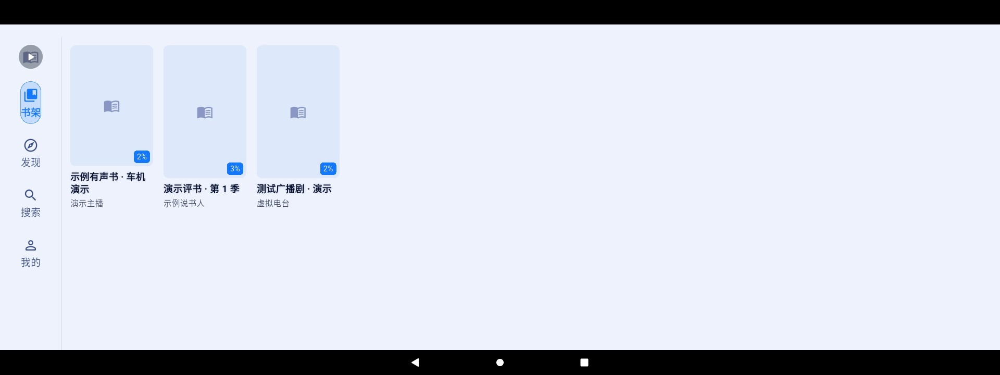
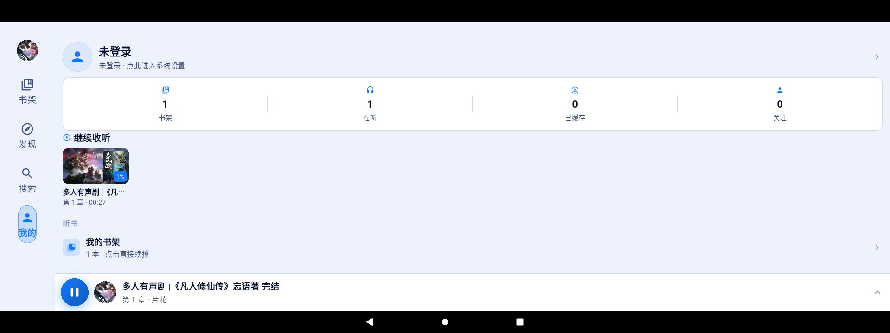
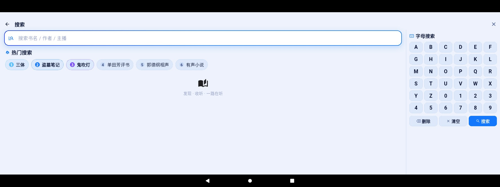
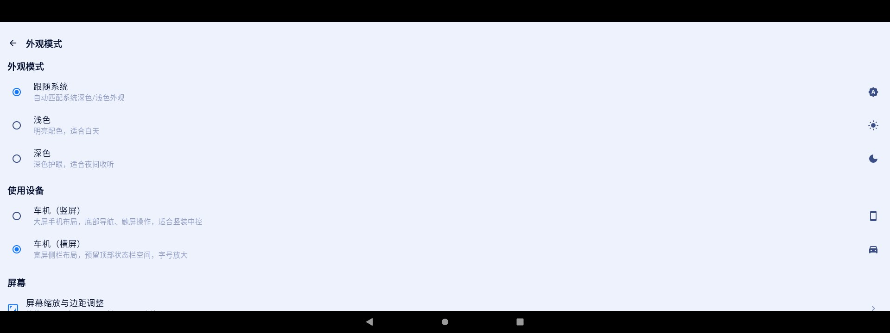
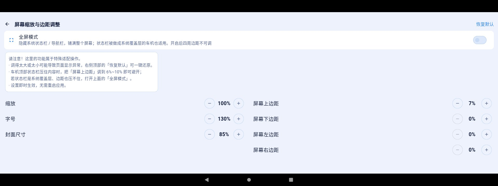

<div align="center">


# 阿B听书 Car

**免登录、无广告、专注收听的第三方 B 站有声小说 · 车机专用版**

Android 7.0+ · 宽屏侧栏 · 大按钮触控 · 永久免费 · 开源

</div>

---

## 这个仓库是什么

**本仓库是从[阿B听书](https://github.com/fengqiao57/abts)复刻的车机优化专用分支**，感谢原作者提供的代码，尊重原作者的知识成果。
本应用只面向车载中控（Android 车机 / 车机盒子）做适配与优化，不再维护手机竖屏为主的交互，也不提供桌面端（Windows）与电视（Android TV）版本。

它把 B 站当作有声书库：搜索、分类浏览有声小说、评书、相声、广播剧，点开即听。针对车机的屏幕比例、观看距离、行车操作场景，重新设计了侧栏、播放页与字号体系。

非官方项目，与哔哩哔哩无任何官方关联或背书；内容来自哔哩哔哩公开视频的音频轨道，应用本身不存储、不修改、不二次分发任何内容。

> 安装包与**每个版本的更新日志**均在 [Releases](https://github.com/DrSkyFree/abts_car/releases) 页面，本仓库 README 不再单独维护更新日志。

## 界面预览

> 为避免出现第三方内容，以下截图使用**虚构示例数据**：书名、主播名均为演示虚构，封面为占位图，不含任何真实作品或用户信息，仅用于说明车机版界面布局。
> 均为 1920×720 车机模拟器实拍，车机预设：缩放 100% · 字号 130% · 封面 85% · 上边距 7%。

**书架（虚构示例书籍）**



**我的 · 继续收听**



**搜索（右侧字母键盘 + 热门分类）**



**车机专有显示设置**

| 外观模式 · 使用设备 | 屏幕缩放与边距调整 |
|---|---|
|  |  |

## 车机适配范围

| 项目 | 说明 |
|---|---|
| 最低系统 | **Android 7.0（API 24）**，覆盖绝大多数停留在 7.0~9.0 的车机与车机盒子 |
| 已验证环境 | Android 11（API 30）模拟器，**1920×720 / 160dpi** 横屏 |
| 屏幕尺寸 | 12~18 寸中控，横屏宽屏 |
| 分辨率 | 720P ~ 2.5K（1280×720 / 1920×720 / 1920×1080 / 2560×1440） |
| 布局策略 | 宽屏统一走「左侧栏 + 内容区」；播放页为「左操作 / 右封面」，符合主驾在左的伸手习惯 |
| 输入方式 | 触屏优先，同时保留方向键/旋钮焦点描边能力（适合带旋钮的车机） |
| 安装包 | 包名 `dev.pages.abts` 不变，签名固定，**可直接覆盖升级**，桌面上仍显示「阿B听书」 |

> 说明：车机系统以 Android 7.x 为下限，高于 12 的车型同样可用；个别把状态栏做成系统覆盖层的车机，需要在「屏幕缩放与边距调整」里把上边距调到 6%~8% 避开遮挡。

## 车机版特性

**车机布局**
- **「使用设备」切换**（我的 → 外观模式）：手机 / 平板 与 车机 两套预设；选车机后自动重启，套用宽屏侧栏、字号放大、顶部留白
- **左侧导航栏 118dp**：书架 / 发现 / **搜索** / 我的，图标与文字同步放大；搜索放在「发现」与「我的」之间，行车中不必滑到最底部
- **主驾视角播放页**：播放操作全部集中在左侧，封面移到右侧并收小，避免遮挡与伸手过远
- **大字可读**：字号、封面、整体缩放、四周边距四项独立可调，即时生效

**屏幕缩放与边距调整**（我的 → 外观模式 → 屏幕缩放与边距调整）
- 缩放：整体字体、按钮、列表尺寸，70%~140%
- 字号：单独调节文字大小，80%~200%
- 封面尺寸：单独调节书籍卡片封面，60%~130%
- 上/下/左/右边距：按屏幕百分比留白，0%~30%，用于避开被系统状态栏/底栏压住的内容
- 一键「恢复默认」；搜索框等控件高度随字号自适应，不会裁字

**质感与可操作**
- 浮动播放器、播放页控制键统一为**亚克力（毛玻璃）面板 + 强调色实心圆按钮 + 光晕**
- 播放键、上一章/下一章、±15 秒按钮在车机下整体放大一档，行车中易辨认、易点中
- 分类标签栏自适应高度，字号放大后不再被截断

**发现与搜索**
- 分类浏览：热门推荐 / 广播剧 / 评书 / 相声 / 悬疑 / 玄幻仙侠 / 名著悦读
- 精选主播：单田芳、刘兰芳、郭德纲、周建龙、紫襟、王明军、光合积木、729声工场 等，一点直达 TA 的作品
- 搜索自动限定在「有声小说」范围，过滤解说、漫推、短视频等无关内容
- 搜索分「听书 / UP主」两个标签（出结果后才出现，切换不闪屏）；UP主标签可搜主播、关注后只看他的内容
- 书籍详情页点 UP 主名可直达 TA 的主页
- 搜索结果上拉分页加载，失败会提示并可一键重试；分类结果本地缓存

**播放**
- 分P 即章节：自动连播、上/下一章、±15 秒快进退
- **倍速播放**：0.5x ~ 3.0x 共 11 档预设，点一下即切换，自动记住上次倍速
- **播完本集自动暂停**：本集播完即停，不自动连下一集（可开关）
- 断点续播精确到秒（退后台、切章节、退出应用都会保存进度）
- **断流自动重连**：长音频中断自动换备用线路并回到原位置
- 章节列表：标题自带序号时不重复编号；已听章节打 ✓ 并置灰，支持正序/倒序
- 睡眠定时：预设 10/15/30/45/60 分钟、2 小时，也可自定义 1~720 分钟
- 音频焦点：来电或其它应用播放时自动暂停，结束后续播；拔耳机自动暂停；提示音只压低音量
- 后台播放：前台服务 + 系统媒体会话，通知栏与锁屏可控制；含「后台留存保护」（电池优化豁免引导）
- **车机语音/方向盘控制**：前台后台都响应「暂停 / 停止」；语音「停止」会先保存进度，再次「播放」从上次位置续播（当前这本优先，其次书架最近在听的一本）

**离线缓存**
- 详情页每集可单独缓存，也可在「缓存选集」里**手动勾选几集**（不提供整本一键下载）
- **7 天有效期**：缓存只作临时离线收听，到期自动删除文件与索引；缓存仅在本应用内播放，不提供导出/分享
- **后台缓存**：开始后可立刻离开页面，回桌面、切页面都不中断下载
- **通知栏进度**：显示正在缓存的集名与百分比，完成后自动消失
- **断了能续**：App 被系统回收或手动划掉重进，下次启动自动接着下完剩余队列
- **失败可见可重试**：失败集不会悄悄消失，会列出原因并支持一键重试
- 离线缓存管理（我的 → 离线缓存）：按书分组、查看已缓存章节、单个/批量删除、可直接播放
- 缓存文件按作品原本章节顺序展示；保存在应用私有目录，覆盖升级不丢
- 下载前预估所需空间，不足会提前提示

**其它**
- 书架收藏、继续收听、最近收听（均显示整本书的进度百分比）
- 书架续播角标：显示上次在听那本的圆形封面，播放时随封面旋转，点一下回到播放页
- 我的页面统计（书架 / 在听 / 已缓存 / 关注）可点击直达
- 关注的 UP 主、播放书签、外观模式（跟随系统 / 浅色 / 深色）
- 扫码登录（二维码可保存到相册）、分享原作品与官网链接
- 手动检查更新：比对 GitHub Releases，只显示最新版本号与发布日期，需自行到仓库下载 APK 安装
- 清理应用缓存（系统设置 → 存储与缓存）：一键清理封面图片与临时文件，不影响离线缓存与书架

## 项目结构

```
lib/
├── core/
│   ├── network/        # BiliClient（Cookie 预热 / WBI 签名 / 限速重试）、CookieJar、端点常量
│   ├── storage/        # 书架与进度、离线缓存（CacheStore：队列/对账/迁移）、关注、搜索历史、书签
│   ├── theme/          # 配色与主题、DisplaySettings（设备/缩放/字号/封面/边距）、
│   │                   # DisplayFrame（全局面板与视口缩放）、WideMode（宽屏/遥控设备判定）
│   └── nav/            # 底部/侧栏 Tab 全局切换
├── data/               # 分类与精选主播种子数据
├── models/             # Book / Chapter / AudioTrack / UpUser
├── player/             # BookPlayer（连播、断点续播、睡眠定时、音频焦点）+ 系统媒体会话桥接
├── services/           # BiliApi 数据层、缓存通知桥、登录态、音频焦点、外链跳转、相册保存
├── pages/              # 书架 / 发现 / 搜索 / 详情 / 播放 / 离线缓存 / 我的 / 外观模式 /
│                       # 屏幕缩放与边距 / 睡眠定时 / 书签 / 关注 …
├── utils/              # 时长、数字、文本清洗等格式化工具
└── widgets/            # 亚克力面板、书籍卡片、封面、焦点环、遥控字母键盘、页面骨架、续播按钮

android/app/src/main/kotlin/dev/pages/abts/MainActivity.kt
                        # 音频焦点、设备形态、电池优化、缓存通知、相册、外链、重启等原生通道
test/                   # 车机布局与显示设置单测（含 1920×720 视口与即时生效断言）
tool/                   # 接口探针脚本（调试用，可独立 dart run）
docs/                   # 官网页面与截图（GitHub Pages）
.github/workflows/      # Android Release 构建与发布流水线
```

## 开源申明与免责声明

> 本节是本项目的使用边界与责任说明。**下载、安装、编译、运行、二次开发或分发本项目（含任何衍生版本），即视为你已阅读、理解并同意本节全部内容。**

### 一、项目性质与适用范围

1. 本项目是由个人开发者发起的**开源技术学习与车机适配测试项目**，目的仅为验证 Flutter 在 Android 车机环境（横屏、旋钮 / 方向键、大字号）下的界面布局、媒体会话与后台播放等**技术能力**。
2. 本项目**不提供任何音视频内容服务**：不内置、不缓存、不托管、不分发、不转码任何音频、视频、封面、文字等作品资源。应用运行时看到、听到的内容，均由使用者通过第三方平台的公开接口自行获取，并仅在使用者本机临时播放。
3. 本仓库的代码与文档中**不包含任何可能构成侵权的商业资源**，包括但不限于付费课程、会员专享内容、影视 / 音乐成品、破解补丁，以及规避技术措施的代码或数据；文档与界面预览中使用的示例数据、截图均为虚构或公开无版权素材。
4. 本项目与哔哩哔哩（bilibili）及其关联主体**不存在任何隶属、代理、合作、授权或认可关系**。文中出现的第三方名称、商标、标识仅用于客观指代与技术兼容说明，相关权利归各自权利人所有。

### 二、权利归属与内容责任

1. 通过本项目访问、播放、缓存的一切作品内容，其著作权及邻接权（表演者权、录音录像制作者权等）均归原作者及相关权利人所有。
2. 本项目**不存储、不修改、不二次分发**任何作品内容。离线缓存等能力仅把使用者本人请求的数据保存在其设备私有目录，供其个人离线收听，不构成本项目对内容的提供或传播。
3. 使用本项目获取、收听内容的合法性由使用者自行判断并承担。请遵守《中华人民共和国著作权法》《信息网络传播权保护条例》等法律法规，在权利人许可或法律允许的合理使用范围内使用，并在试听后支持正版。

### 三、使用者的合规义务

下载、安装、运行本项目，或对其进行二次开发、测试、分发、预装的单位和个人，应当自行确保其行为符合以下要求：

1. 遵守本仓库的 MIT 开源许可、GitHub 服务条款，以及所在国家 / 地区的法律法规与监管要求；
2. **不得将本项目（含衍生版本）用于任何形式的商业牟利**，包括但不限于售卖、付费下载、预装捆绑、广告分成、会员收费，或以本项目名义接受捐赠、赞助；
3. 不得利用本项目批量抓取、镜像、录制、转存、传播他人作品，不得绕过或破坏权利人的技术措施、付费机制与访问限制；
4. 不得删除或修改本声明、开源许可与版权声明。二次开发产生的功能变更、内容来源与合规责任，由二次开发者独立承担；
5. 不得以本项目名称、作者名义，或以任何暗示官方授权、官方背书的方式发布衍生版本。

### 四、免责与责任限制

1. 本项目按**「现状」（AS IS）**提供，不附带任何明示或默示的担保，包括但不限于可用性、稳定性、无错误、不中断、适销性、特定用途适用性，以及**不侵犯第三方权利**的担保。
2. **在法律允许的最大范围内**，本项目的作者与贡献者不对下列情形承担责任：
   - 因下载、安装、运行、升级、卸载本项目造成的任何直接或间接损失（数据丢失、设备或系统异常、播放中断等）；
   - 使用者或第三方借助本项目获取、播放、缓存、传播内容而引发的任何权利主张、投诉、索赔、行政处罚或刑事责任；
   - 任何第三方对本项目进行二次开发、修改、再分发、预装、售卖后产生的全部后果；
   - 任何以牟利为目的使用本项目（含衍生版本）的行为及其后果。
3. 使用者因违反本节约定或相关法律法规而产生的法律责任，由使用者**独立承担**；如因此使作者或贡献者遭受损失（含合理的律师费、诉讼费等），使用者应予赔偿。
4. 本节不排除或限制依照适用法律不得排除、不得限制的责任（例如因故意或重大过失造成的损害，以及依法应承担的人身损害责任）。

### 五、侵权通知与处理

1. 本项目尊重知识产权。权利人如认为本项目（含代码、文档、截图、示例数据或具体功能入口）侵犯其合法权益，请通过 [Issues](https://github.com/DrSkyFree/abts_car/issues) 或仓库公开的联系方式提交**权属证明、侵权内容的具体位置与说明**。
2. 收到符合前述要求的通知后，作者将在核实后及时采取删除、屏蔽、断开相关入口或说明等措施，并对同类问题做整体排查。
3. 对于明显缺乏依据、恶意或滥用的投诉，作者保留作出说明与依法抗辩的权利。

### 六、其他

1. 本节内容可能随项目迭代更新，更新后自发布之时生效；继续使用即视为接受更新后的说明。
2. 若本节任何条款被有权机关认定为无效或不可执行，不影响其余条款的效力。
3. 本节未尽事宜，适用中华人民共和国法律（不含冲突法规则）；因本项目产生的争议，由作者所在地有管辖权的人民法院管辖。

## 开源协议

本项目以 [MIT License](LICENSE) 开源。在遵守 MIT 许可（保留版权声明与许可声明）的前提下，你可以自由使用、修改与分发本项目代码。

需要特别说明：

- MIT 许可**仅授予代码层面的权利**，不授予任何第三方作品、内容资源或商标的任何权利；
- 二次开发与再分发时，请保留本仓库的版权声明、许可文本与上述「开源申明与免责声明」，不得暗示获得原作者或第三方平台的官方授权；
- 本项目名称「阿B听书」与作者标识不随代码一并授权，衍生版本请使用自己的名称与标识，避免混淆来源。

## 致谢

参考与借鉴了以下开源项目的思路：PiliPlus、biu、bbplayer、bili-music、BiliPai 等。
